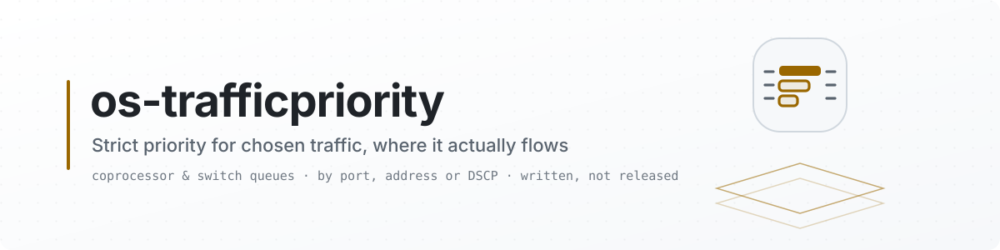

<picture>
  <source media="(prefers-color-scheme: dark)" srcset="docs/images/readme/banner-dark.svg">
  <source media="(prefers-color-scheme: light)" srcset="docs/images/readme/banner-light.svg">
  
</picture>

<p align="center">
  <a href="https://github.com/AbdelmonemAwad/os-trafficpriority/releases/latest"></a>
  <a href="https://github.com/AbdelmonemAwad/os-trafficpriority/actions/workflows/checks.yml"></a>
  <a href="LICENSE"></a>
  <a href="#what-is-tested"></a>
  <a href="https://github.com/AbdelmonemAwad/opnsense-arabic"></a>
  <a href="https://github.com/AbdelmonemAwad/os-xgs-npu"></a>
</p>

# Traffic Priority for OPNsense

Priority for chosen traffic - voice, games, the firewall's own management. The goal is strict priority where that traffic actually flows, in the queues of an XGS appliance's coprocessor and switch, which forwarded traffic never leaves. The first part marks the chosen connections with a DSCP, through pf; the second, on an XGS 3300 with os-xgs-npu, gives the first two DSCPs a queue of their own in the switch - strict, or weighted with a guaranteed minimum - setting the DSCP of every other IPv4 connection to 0 meanwhile, and follows Firewall: Shaper into the switch where the switch can do what a rule does; the third chooses connections by who opens them and what they go to - groups and users of os-useridentity, applications and categories of os-appcontrol - through those plugins' own tables.

> ~~**Planned - nothing here runs yet.** This repository was opened on 2026-10-22 to hold
> Traffic Priority as a plugin of its own. No code has been written or moved into it, and there is no
> release.~~
>
> ~~**Written, not released (2026-11-17).**~~ **1.0.0, the first release (2026-11-18).** The first part is here: classes of connections, each
> marked with a DSCP by pf. Tried the same day on a lab appliance, an XGS 3300; what was run is under
> [What is tested](#what-is-tested).
>
> ~~**The second part, written, not released (2026-11-19):**~~ **The second part, merged 2026-11-20
> ([#5](https://github.com/AbdelmonemAwad/os-trafficpriority/pull/5)), not released:** the switch's
> queues, a minimum for a class, and Firewall: Shaper followed. It needs os-xgs-npu's switch tool
> (`switch_qos.py`, ~~in os-xgs-npu's pull request of the same day~~ in os-xgs-npu's main since
> 2026-11-20, [os-xgs-npu#1201](https://github.com/AbdelmonemAwad/os-xgs-npu/pull/1201)). Both ran on
> the second XGS 3300 on 2026-11-19: what was measured there is said below, and what was not;
> os-xgs-npu turning port 0's pause off itself, which the minimums need, ~~has not run on an appliance
> yet~~ ran there too, through this plugin's Apply and after a full reboot.
>
> **The third part, written, not released (2026-11-20):** a class's groups and users, of os-useridentity,
> and applications and categories, of os-appcontrol, as those plugins' pf tables - read here, never
> written. It has not run on an appliance yet: its checks ran away from one ([What is tested](#what-is-tested)).

<p align="center"><b>Contents:</b> <a href="#what-it-does">What it does</a> &middot; <a href="#how-a-class-marks-its-connections">How a class marks its connections</a> &middot; <a href="#groups-and-users-applications-and-categories">Groups and users, applications and categories</a> &middot; <a href="#the-switchs-queues">The switch's queues</a> &middot; <a href="#following-firewall-shaper">Following Firewall: Shaper</a> &middot; <a href="#on-a-sophos-xgs">On a Sophos XGS</a> &middot; <a href="#not-yet-and-why">Not yet, and why</a> &middot; <a href="#what-is-tested">What is tested</a> &middot; <a href="#installation">Installation</a> &middot; <a href="#updates">Updates</a> &middot; <a href="#where-it-fits">Where it fits</a> &middot; <a href="#licence">Licence</a></p>

## What it does

**Firewall: Traffic Priority** (XGS: Traffic Priority when os-xgs-npu is installed), one page:

- **classes** - each one a description, a sequence, and what it matches: the interfaces connections
  come in on (none chosen: every one), the IP version (IPv4 by default), the protocol, the source and
  destination (addresses, networks, aliases, an interface's network, the firewall itself), their
  ports (a number, a name, a range or an alias of ports), and the DSCP a connection arrives with
  (any by default); and the DSCP to set, EF (46) by default, one of the 21 code points Firewall:
  Shaper names. And **groups and users** of os-useridentity, **applications** and **application
  categories** of os-appcontrol, in place of the source and the destination
  ([Groups and users, applications and categories](#groups-and-users-applications-and-categories)). A
  class has to narrow what it marks by at least one of these, the protocol and the IP version aside. And
  a **minimum**, a percent of a full port its switch queue gets at least
  ([The switch's queues](#the-switchs-queues)); none by default;
- **the rules** - registered by the plugin at every filter reload (`plugins.inc.d/trafficpriority.inc`,
  the way os-blocklists registers its own), one pf `match` rule for each interface, IP version and
  pair of addresses a class names. They are never added to the owner's own rules, so turning the
  plugin off or removing it leaves nothing there. Firewall: Shaper and Firewall: Settings:
  Normalization are neither read nor written;
- **Applied** - for each class, what pf holds of it: its rules - or written to the rules file and
  not loaded - the connections pf counted for them, open now and since the last filter reload, the
  packets and bytes it saw, and - when a class makes no rule - why. Those counts are pf's for the
  rules loaded by the last filter reload, so every reload, an Apply among them, starts them again
  from 0, while connections keep their mark; a connection that two classes match is counted under
  both. The card above them, **Marked now**, counts each connection pf holds with a mark set coming
  in, once, whenever it opened, while a class marks (`pfctl -v -s states`). pfctl shows that a mark
  is set, not which one: on FreeBSD 15.1 it reads the states over netlink, whose export carries the
  state's flags and not its TOS byte (`pf_nl.c:148-230`), so it prints every mark as `set-tos 0x00` -
  as an XGS 3300 on OPNsense 26.7.9 showed, a class's EF on the wire. So an owner's normalization
  rule setting any mark on connections coming in is counted too. When pf refused the rule set of the
  last filter reload, or the running OPNsense has no key to write the mark with, the page says so
  rather than that nothing was applied yet. And each class's **Switch queue**: queue 7 or 6, strict
  or weighted with its minimum, or why it has none - pf alone (the switch's two places taken), Best
  Effort, IPv6, or no switch os-xgs-npu sets on this appliance. A card says how many DSCPs have a
  queue, and what the last Apply did with the switch. And **Their tables**: each group, user,
  application and category of a class, with its table and how many addresses pf holds in it now, or
  why it has none;
- **Firewall: Shaper** - each of its rules, read and never written, with what the switch takes of it
  and what stays with the host, and why ([Following Firewall: Shaper](#following-firewall-shaper));
- **General** - Enabled, **off by default**: nothing is marked and nothing of the switch is set until it
  is switched on and Applied. **Follow Firewall: Shaper**, off by default.

Off, the rules are gone at the next filter reload; Apply then puts back what it set in the switch, as
it found it; the classes stay.

## How a class marks its connections

A class is one rule like this, written by OPNsense's own rule class into `/tmp/rules.debug`:

```
match in on igb1 inet proto udp from {any} to {any} port {5060} scrub ( set-tos 0xb8 ) label "trafficpriority-<the class's ID>" # Traffic Priority: Voice
```

Read in FreeBSD 15.1's pf, which OPNsense 26.7 runs (opnsense/src stable/26.7 at `1633399de9dd`),
and in OPNsense 26.7's filter code:

- **a match rule decides nothing** - pf applies its actions and goes on to the next rule
  (`pf.c:5836-5867`), so the owner's rules still pass or block. It is never quick: pf stops at a
  quick rule that matches, a match rule too (`pf.c:5891`);
- **it comes first** - priority 0, before every rule OPNsense writes (its own begin at 1), so no
  quick rule ahead of it can leave it unread;
- **the mark goes with the connection, both ways** - the state the owner's pass rule makes takes the
  match rules' actions (`pf.c:5867`, `6274`), and every packet of the state, either way, gets them
  (`pf.c:11389`, `11401`): the DSCP written, the two ECN bits kept as they came (`pf_norm.c:2245-2262`);
- **a mark is fixed when a connection opens** - a class changed, added or removed reaches the
  connections opened after the Apply; open ones keep what they opened with until they end. Nothing
  here cuts a connection;
- **of two classes that match one connection, the lower sequence wins** - pf applies every match
  rule that matches, in order, and the last DSCP set stays (`pf.c:5039-5056`), so the classes are
  registered highest sequence first. Of two with the same sequence, the one first in the list wins;
- **the IP version of a class is what its addresses allow** - an IPv4 source with an IPv6 destination
  is no rule at all, because pfctl refuses such a rule (`parse.y:6346-6351`, `6533`) and with it the
  whole rule set, every rule of the owner's too. The page refuses such a class at the save, and the
  hook writes no rule for one written by other means, nor for a port without TCP or UDP
  (`parse.y:5309`), nor for an interface or address field it cannot read, and says why in the system
  log (`Traffic Priority:`) and on the page;
- **a class narrows what it marks** - by an interface, a source, a destination, a port or the DSCP a
  connection arrives with. One with none of them would mark every connection, both ways, every
  download among them, and networks upstream and Wi-Fi take a mark such as EF for voice. The page
  refuses such a class at the save, and the hook writes no rule for one written by other means;
- **nothing that would break the rules file is written** - config.xml can be written by other means
  than the page, and OPNsense writes some fields as they are given: a port it cannot map into a
  `#debug:` comment and into the rule it comments out, the description at the end of the line. So a
  port is taken as a number, a range whose first port is not above its second, a name or an alias of
  ports, and nothing else: not with a line break in it, which would start a line pf loads, nor an
  alias of addresses, which 26.7 to 26.7.7 write as a port, nor a range the wrong way round, which
  26.7 to 26.7.5 write as it is (`parse.y:3836-3840`) - pfctl refuses either, and with it the whole
  rule set. Nor a description ending in a backslash, which pfctl takes as joining the next line to
  it, a comment's too (`parse.y:6806-6814`, `6882-6883`), so that the next rule would quietly not be
  loaded. The page refuses each at the save - a class is read whole when any field of it changes -
  and the hook writes no rule for one written by other means;
- **"Arriving with DSCP" is pf's `tos`** - matched on the packet that opens the connection, its ECN
  bits aside. pf cannot match 0, which it takes for no DSCP asked (`pf.c:5805`), so Best Effort is
  not offered there.

**Why a match rule, and not the normalization rule os-xgs-npu measured with.** A plugin cannot add a
normalization rule: OPNsense writes the owner's own there and nothing else (`filter.inc:468-546`).
And pf reads those rules at the IP header without their ports, the first that matches setting its
mark (`pf_norm.c:1167-1203`, `1321-1354`): read in the source, a normalization rule with a port and a
TOS / DSCP marks every connection that matches the rest of it, whatever its port. Not measured. A
match rule checks its ports (`pf.c:5763-5770`).

**The key the mark is written with.** OPNsense 26.7.9 has one of its own for pf's scrub options on a
rule (`scrub`, `FilterRule.php:58` there). 26.7 to 26.7.8 have none, and the plugin writes the same
text through the key those versions write as given (`dn`, `FilterRule.php:69`; set by OPNsense only
from a Shaper rule's pipe or queue, which a class never has). Which one is used is read from the
running OPNsense's own rule class; where neither is there, no class is applied and the system log
says so. The checks write every sample class out with the rule classes of both OPNsense 26.7 and
26.7.9 ([What is tested](#what-is-tested)).

## Groups and users, applications and categories

A class may name groups and users of [os-useridentity](https://github.com/AbdelmonemAwad/os-useridentity)
and applications and categories of [os-appcontrol](https://github.com/AbdelmonemAwad/os-appcontrol):
each plugin's own pf tables - aliases of type External it writes and fills - which this one reads at
every filter reload and never writes (`OPNsense\TrafficPriority\Sources`; `scripts/trafficpriority/sources.py`
for the page and the switch):

- **groups and users** - User Identity's group rows and user rows, chosen in the dialog from its own
  lists and kept by each row's ID, as os-blocklists keeps them. A row's table holds the addresses User
  Identity has mapped to that group's users, or to that user, now, and is the class's source. Each
  address comes from an event that named it: a domain controller's logon (event 4768) names the address
  the user logged on from, usually IPv4 (`::ffff:a.b.c.d` in the event); a RADIUS accounting record or a
  captive portal session names its own. A device's connections from its other addresses are not the
  class's: a device on both IP versions prefers IPv6 where both work, and sends from temporary IPv6
  addresses that no event names, so on such a network the class marks the user's IPv4 connections only,
  whatever its IP version - the switch's queues are IPv4's anyway. Only the connections a user's device
  opens are the class's, never those opened to it from elsewhere, which would otherwise take the class's
  mark just by connecting in. They take the place of Source, which stays any: pf reads every address of a
  rule's source as either, so a Source beside them would widen the class, not narrow it, and the page
  refuses one at the save;
- **applications and categories** - those Application Control keeps a table for, by the names nDPI
  gives them: each application chosen there in Application tables or Blocked applications, or in its
  Rules tab where it has one (os-appcontrol's third part), and applied, and every category of the
  installed nDPI while it classifies. A table holds the servers nDPI named as that application, or as one
  of the category, and is the class's destination. They take the place of Destination likewise. A
  connection to a server of any of a class's applications and categories is the class's. A blocked
  application's table holds only the servers the firewall's own resolver vouched for, and its block rule
  stops every new connection to them, so a class that names it marks only what the block lets through -
  with Application Control's Rules, the devices outside a rule's source;
- **the rules** - one pf `match` rule for each interface, IP version, table of a group or a user and
  table of an application or a category, as for a class's addresses, the rest of the class - its
  protocol, ports, DSCP to arrive with - in each:

  ```
  match in on igb1 inet from $uid_staff to $appcontrol_Zoom scrub ( set-tos 0xb8 ) label "trafficpriority-<the class's ID>" # Traffic Priority: Calls
  ```

  OPNsense's own rule class writes each table as its alias's macro (`Rule.php:61-66`, `87-93`), which
  OPNsense defines in the rules file with its table for every alias of config.xml (`filter.inc:619`,
  `621`), so a rule never names a table pfctl is not given. The rules multiply: 2 groups and users, 3
  applications and categories, 2 interfaces and both IP versions are 24 rules, and pf reads each for
  every new connection - choose one group rather than many users, or one category rather than many
  applications, where they mean the same;
- **only their own tables** - a table is taken only as its plugin's alias, External and switched on,
  while that plugin is on - User Identity's Enabled, Application Control classifying - and, for a group
  or a user, its row switched on. Anything else adds nothing, and the Applied tab says why for each: the
  plugin not installed or off, the row switched off or gone, not applied there yet, an application not
  chosen there for a table, the table switched off, an alias of the row's name that is not User
  Identity's;
- **no table, no rule** - a class whose groups and users have no table now, or whose applications and
  categories have none, makes no rule: never one from every source or to every destination. The system
  log says so at each filter reload. On an XGS 3300 the class keeps its switch queue all the same - its
  settings decide the places, as at the save, so the other plugins' state never moves the queues of
  the classes after it - and marks again once its tables are there: their plugin's Apply reloads the
  filter, which writes its rules again, with no Apply here. Kept with the queue, for a class that marks
  nothing meanwhile: the switch's entry for its DSCP, the rule setting the DSCP of every IPv4 connection
  no class marks to 0, and with minimums port 0's pause off (1 to 4 % of the line rate, and more
  retransmissions). The reload records the class it left so in its rules file, a line written commented
  out that pf never reads, and Apply takes the switch's places from that same file;
- **a mark is fixed when a connection opens** - a connection a device opened before its address joined
  a user's table keeps the mark it opened with; where os-xgs-npu's cut list holds User Identity's
  tables, such a connection is cut as the address joins one, and opens again marked. A connection to an
  application's server is marked only when the server is in the table as the connection opens, and keeps
  that for its whole life. nDPI names a connection 10 to 70 seconds after it begins - Application
  Control's windows of a minute - and the server then stays in the table for Application Control's
  Expire (an hour by default) after the last new connection named to it. So:
  - the first connection to a server new to the table is not marked, for its whole life - a call's
    media among them, one long flow that begins with the call;
  - a connection opened to that server while it is in the table is marked;
  - nor is one opened once an Expire has passed with no new connection named to its server: a call going
    on, however long, does not keep its server in the table;
  - to mark a call from its first packet, add beside the class one with the same DSCP by the call's own
    ports, or by an alias of the servers its service publishes (Firewall: Aliases, URL Table); a longer
    Expire in Application Control keeps a server in the table longer between calls;
- **the page** - the Applied tab's Their tables column: each group, user, application and category of a
  class, with its table and how many addresses pf holds in it now - every table's count from one
  `pfctl -vv -s Tables`, rather than every address of each listed to count it - or why it has none. The
  Classes tab says when os-useridentity or os-appcontrol is not installed: Groups and
  users, or Applications and Application categories, then offer nothing - and when Application Control is
  installed and keeps no table at all, not classifying or not applied there yet. Installed is read from each
  plugin's model file, by the page, the dialog and the rules hook alike - each plugin's removal leaves its
  settings in config.xml, its rows and its Enabled among them - and a choice saved before a removal stays
  in the class, marked as not installed.

## The switch's queues

On an XGS 3300 with os-xgs-npu, Apply gives the switch what the classes ask for, through os-xgs-npu's
switch tool (`scripts/xgs/switch_qos.py`): `scripts/trafficpriority/apply.py` decides (`hardware.py`)
and writes it into the tool's settings file, `/var/db/os-xgs-npu/switch-qos.json`, and the tool sets it,
keeps what it found, and sets it again after every boot of the coprocessor, whose boot erases the
switch's registers. Apply runs it in the background after the filter reload; the page says while it
runs and what it did.

- **why the switch needs telling** - every frame the coprocessor sends into its switch waits in queue
  0, marked or not
  ([qsched-2026-10-25](https://github.com/AbdelmonemAwad/os-xgs-npu/blob/main/docs/measurements/qsched-2026-10-25.md)).
  A TCAM entry on the switch's port 0 that picks a DSCP out of those frames sets their queue instead,
  for every front port behind the switch at once - measured on an XGS 3300 on 2026-11-17 with EF and
  queue 7: a stream marked EF took 922 to 931 Mbit/s against 0 to 16 for an unmarked one, the two
  together at 928 to 941 Mbit/s in every run
  ([a4-2026-11-17.png](docs/images/measurements/a4-2026-11-17.png));
- **two DSCPs at most** - two TCAM entries are free on the XGS 3300. The rules hook gives them, at
  every filter reload, to the DSCPs of the classes switched on that make a rule, in the page's order
  (by sequence, then as listed): IPv4 - the entry picks out IPv4 - and above Best Effort, so not Best
  Effort, CS1 or LE. Classes of one DSCP share its queue. A class of a third DSCP is marked by pf and
  nothing more, and the page says so. A class of groups and users, applications or categories takes its
  place by the same order; one whose tables are missing now keeps it
  ([Groups and users, applications and categories](#groups-and-users-applications-and-categories));
- **while a class has a queue in the switch, every IPv4 connection no class marks has its DSCP set
  to 0, both ways: the switch queues every frame by its DSCP** - its entry picks out every frame with
  a class's DSCP, whoever marked it: a computer marking its own traffic EF, a download arriving with
  EF. So while a class has a queue there, the rules hook writes one rule before every class's, on every
  interface - `match in inet all scrub (set-tos 0x00)`, IPv4 alone, as the entry picks out IPv4 alone -
  and the classes' rules come after it and mark their own connections: pf keeps the last match rule's
  mark, and writes it on a connection's packets both ways. Measured on an XGS 3300 on 2026-11-19: a
  class marking DSCP 0 put the replies of its connections, sent marked EF, into queue 0; with a rule
  for the connections opening with EF alone, which this one replaced, a connection opened unmarked had
  put 83,771 frames of replies marked EF into queue 7. Connections the firewall opens itself are not
  among them: the rule, as the classes', is read where connections come in. Its `label` is
  `trafficpriority-clear`, and the switch is given the classes' DSCPs only while the rules file holds
  it;
- **strict, or minimums** - classes in the switch without a minimum are strict: their queues go before
  every other, top queues first (7, then 6), and can take a whole port - the stream above did. With
  minimums they are weighted: under full load each queue keeps at least its part of the port, and the
  rest of the traffic (queue 0) keeps what is left. To keep the parts, os-xgs-npu turns off flow
  control - the pause - on the coprocessor's uplink, the switch's port 0, after it writes the weights,
  and puts it back as it found it, first, when they go: the switch then drops what the coprocessor
  sends beyond what a port takes, instead of holding the coprocessor back. With the pause on the parts
  never showed: the queue a class fills first held the whole backlog the pause lets in, and the other
  queue's frames were dropped as they arrived. Measured on the second XGS 3300 on 2026-11-19 into a
  full Port8, the pause turned off by hand: minimums of 30 and 20 gave 57.9 against 38.7 Mbit/s by UDP
  at a 100 Mbit/s port and 534.5 against 370.5 by TCP at line rate, where with the pause on they had
  87.2 against 9.6 and 913.6 against 17.7; a minimum of 30 against the 50 left to the rest of the
  traffic gave 352.4 against 568.9. The cost: 1 to 3 % of the line rate for two streams, 4 % for one
  alone, and more retransmissions
  ([switch-weights-2026-11-19](https://github.com/AbdelmonemAwad/os-xgs-npu/blob/main/docs/measurements/switch-weights-2026-11-19.md)).
  Strict classes leave the pause as found. The two are not mixed - a strict queue would go
  before the weighted one and leave it no minimum: every class with a switch queue has a minimum, or
  none has. The page refuses the mix at the save, and Apply gives the switch nothing while config.xml
  holds one, and says why;
- **one set of weights** - the switch has one weight sequence for the whole chip, so a minimum is the
  same part on every port in weighted mode, the coprocessor's own uplink among them. The sequence
  gives each queue its percent of turns and every queue at least one turn: queues 1 to 6, which no
  class takes, get one each - frames the clients mark themselves (DSCP 8 to 55) wait in them on the
  switch's way into the coprocessor, and when that link is full each queue gets about one turn in a
  hundred. The minimums of the classes switched on add up to 100 at most, and a minimum on a class
  without a queue of its own is refused at the save;
- **the TCAM is shared** - the coprocessor's network agent loads entries through the same command
  engine as the host, with no lock between them. So os-xgs-npu reads each entry back in the session
  that loads it and flushes it at once if it does not read as written; reads the vendor's entries
  beside ours before and after it writes, and does not keep a run during which they changed; and reads
  entries 3 and 255, port 0's mode and its pause again whenever the page asks the status - the card
  says so when they no longer hold what Apply set;
- **putting back** - Traffic Priority switched off, or removed, takes its settings file for the switch
  away first, then os-xgs-npu puts back what it set, as it found it. What cannot be put back is never
  set again: it stays in os-xgs-npu's state, put back at the next boot of the coprocessor, and the page
  says the put-back failed;
- **the pause turned off by os-xgs-npu itself** - measured on the second XGS 3300 on 2026-11-19 through
  this plugin's Apply: minimums of 30 and 20 gave 58.0 against 38.8 Mbit/s by UDP, a minimum of 30
  against the 50 left to the rest of the traffic 36.4 against 60.5, and 60 % against 40 % by TCP at line
  rate, for 1 to 4 % of the rate and more retransmissions; strict classes alone left the pause as
  found; after a full reboot the boot hook set it all again; and turned off, the switch read as before,
  with nothing of the plugin's left;
- **not measured yet** - ~~os-xgs-npu turning the pause off itself (for the runs above it was turned off
  by hand),~~ a part from a Firewall: Shaper weight with the pause off, the other front ports while one
  is full with the pause off, and whether the switch counts its turns in frames or in bytes. Measured
  besides on 2026-11-19: pf's mark from a class into its queue - entry 3 counted 78,691 frames of a
  class's, and queue 7 sent 78,690 of them - and entry 255, behind the vendor's drop-all 254, counting
  79,086 of the other class's; and the weight sequence written, 105 turns, and read back.

Not on the XGS 136 yet: its switch is the same chip, but its network agent shares the bus, and the
host's reads have taken ports down there (os-xgs-npu #639, #706), so os-xgs-npu only reads it, and the
page says the queues are not applied on this model. Not on the XGS 2100, 2300 and 3100 either, which
nothing was run on: os-xgs-npu writes the XGS 3300's switch alone. Nor on the front ports on the
coprocessor's own MACs (the XGS 3300's F1 and F2): they are not behind the switch.

## Following Firewall: Shaper

With **Follow Firewall: Shaper** on, Apply reads Firewall: Shaper's pipes, queues and rules
(`scripts/trafficpriority/shaper_map.py`) - never writes them - and gives the switch what it can do of
each rule. The Firewall: Shaper tab lists every rule with what the switch took and what stayed with the
host:

- **a queue's weight** - a rule on a front port behind the switch that sends one DSCP into a queue of a
  pipe gives that DSCP the queue's weight, against the other queues of its pipe, as a part of every
  port - when a class here marks the DSCP and it has one of the switch's two queues; when the queue and
  its pipe have no mask (a weight for each address is not a part of a port) and the pipe's scheduler
  shares by weight (WF2Q+, Deficit Round Robin, QFQ - not FIFO, FlowQueue-CoDel or FlowQueue-PIE);
  and when no class has a minimum of its own, every switch queue gets a part, and the parts add up to
  100 at most;
- **a pipe's bandwidth** - a front port's egress limit, when a rule sends everything leaving that port
  into the pipe: any protocol, source and destination, no port, DSCP or length, the way out (both ways:
  the way in stays with the host), a pipe without a mask, and no rule before it on that interface and
  way that sends into another pipe - ipfw stops at the first rule that sends a packet to a pipe or a
  queue, so a later rule sees only what that one leaves. The switch limits a port, all of it, in steps
  of 1 Mbit/s up to 100 Mbit/s and 10 Mbit/s up to 1 Gbit/s: the tab shows the step written - a pipe of
  155 Mbit/s is 150 at the port;
- **with the host** - everything else, with why: a rule that matches no DSCP or more than one, a DSCP
  no class marks or pf alone marks, a rule on an interface outside the switch, a pipe's limit for one
  kind of traffic, the way in, a limit or a weight for each address, a scheduler that does not share by
  weight, an earlier rule on the interface, a part that cannot be kept.

Firewall: Shaper still shapes on the host: os-xgs-npu keeps every connection an enabled rule of it
names with the host, off the hardware
([shaper-3300-2026-10-20](https://github.com/AbdelmonemAwad/os-xgs-npu/blob/main/docs/measurements/shaper-3300-2026-10-20.md)).
What is followed into the switch is added at the ports. Not measured yet: a part or a limit from a
rule.

## On a Sophos XGS

What was measured: with this plugin's class on an XGS 3300, and before it, by
[os-xgs-npu](https://github.com/AbdelmonemAwad/os-xgs-npu), with OPNsense's normalization rule:

- **a class's mark kept in hardware, on the XGS 3300** - on 2026-11-17, a class marking UDP with
  EF: what arrived at the far end carried TOS 0xb8 while the connection was in hardware, and 0x0
  without the class ([What is tested](#what-is-tested)). Not yet measured on the XGS 136 with a
  class;
- **an IPv4 connection in hardware keeps pf's mark** - since 2026-10-24 both drivers give a
  connection they make the DSCP pf's state carries, on the XGS 3300 and the XGS 136
  ([flow-dscp-2026-10-24](https://github.com/AbdelmonemAwad/os-xgs-npu/blob/main/docs/measurements/flow-dscp-2026-10-24.md)).
  The drivers read the state's actions, the same field a match rule fills (`octep_pf_tos_scan`,
  `npuep_pf_tos_scan`);
- **a marked IPv6 connection stays with the host** - the fast path does not write an IPv6 traffic
  class, on either appliance, so pf writes it there and the connection is not forwarded in hardware
  ([flow-dscp6-2026-10-24](https://github.com/AbdelmonemAwad/os-xgs-npu/blob/main/docs/measurements/flow-dscp6-2026-10-24.md)).
  That is why a class is IPv4 unless told otherwise;
- **the switch queues every frame from the coprocessor in queue 0** - marked or not, whatever port 0's
  ingress map says
  ([qsched-2026-10-25](https://github.com/AbdelmonemAwad/os-xgs-npu/blob/main/docs/measurements/qsched-2026-10-25.md)),
  and the connection's priority bit and the coprocessor's QoS commands have no effect with its
  firmware ([port-qos-2026-10-24](https://github.com/AbdelmonemAwad/os-xgs-npu/blob/main/docs/measurements/port-qos-2026-10-24.md)).
  So a mark alone moves no frame ahead of another in the switch: the switch's own entry does
  ([The switch's queues](#the-switchs-queues)).

A connection in hardware adds no more to the packets and bytes pf counts for its class; its state
stays counted while it is open.

## Not yet, and why

- **os-xgs-npu turning port 0's pause off itself** - the switch's queues were written on 2026-11-19,
  with os-xgs-npu's switch tool, and run on the second XGS 3300 the same day; the minimums held there
  once port 0's pause was turned off by hand ([The switch's queues](#the-switchs-queues)), and the
  switch tool now turns it off itself while it writes weights - ~~not yet run on an appliance~~ run on the
  second XGS 3300 the same day through this plugin's Apply ([The switch's queues](#the-switchs-queues)). Measured
  before them, on the second XGS 3300 on 2026-11-17, with a switch entry written for the test and
  taken away after: EF from the coprocessor in queue 7, TCP at line rate. A stream marked EF took 922
  to 931 Mbit/s and left an unmarked one 0 to 16, against 370 to 564 each without the entry; the two
  together stayed at 928 to 941 Mbit/s in every run. So a class for a bulk stream would starve the
  rest, and a minimum is what protects them. The runs, photographed:
  [a4-2026-11-17.png](docs/images/measurements/a4-2026-11-17.png). To be measured with these classes:
  a part from a Firewall: Shaper weight, a pipe's limit at the port.
- **the XGS 136, and installing and removing on an appliance** - on 2026-11-17 the rules pfctl
  loads, the mark in hardware with a class's match rule, Marked now and a refusal were tried on an
  XGS 3300, with this branch's files where the installer puts them ([What is tested](#what-is-tested)).
  Not yet on the XGS 136, where only a normalization rule's mark was measured in hardware; nor
  `install.sh` and `uninstall.sh` run on an appliance, nor the page photographed in a browser.
- **the firewall's own outgoing connections** - a class matches where connections come in, so a
  connection the firewall opens itself (its own DNS queries, say) is not marked; one opened to it -
  the GUI, SSH - is, both ways.
- **connections a port forward passes** - a port forward (Firewall: NAT: Destination NAT) whose
  Firewall rule is set to Pass is written `rdr pass`, and pf then takes the NAT rule as the one that
  decides and reads no filter rule for its connections (`pf.c:6036-6038`) - no class's either, so
  they keep the DSCP they arrive with. With Register rule, or Manual and a rule of one's own, they go
  through the filter rules, and a class marks them. The Interfaces help says so.
- **Firewall: Shaper and the mark** - probably seen on uploads only; not measured. pf writes the mark
  as a packet comes in on the class's interface, and on a reply as it leaves by it. With a class on
  the LAN, a Shaper rule on the WAN's way out sees the mark, and one on the WAN's way in sees the DSCP
  a download arrives with, which pf rewrites only as it leaves by the LAN. Which of ipfw and pf goes
  first on one interface was not checked. The Set DSCP help says so.
- **IPv6 in hardware** - see above: a marked IPv6 connection stays with the host.
- **the XGS 136's switch** - only read by os-xgs-npu, for the reasons above; the page says so.
- **groups and users, applications and categories on an appliance** - written on 2026-11-20 and run in
  the checks alone, not yet on an appliance: neither the classes' rules on the tables os-useridentity
  and os-appcontrol fill there, nor the two tests their part of the plan sets - a video call and a large
  download on one port, the call in the high queue; two users on two devices, a high class for one, its
  share under load higher and its minimum kept. The call is to be run both ways: to a server already in
  the application's table, and as a first call to a server new to it, which stays unmarked.
- **the first call to a server new to an application's table** - not marked, for its whole life, and no
  more is the first after an Expire (above). pf fixes a connection's mark when it opens and has no way to
  change it after; only cutting the connection would, and nothing here cuts one. What would mark it is
  the server in the table before its first connection, which Application Control does not do: it puts a
  server there once a connection to it has been named. Until it does, a class by the call's own ports, or
  by an alias of the servers its service publishes, marks a call from its first packet.
- **an application's servers, as nDPI names them** - Application Control puts a server in the table of
  an application it does not block by the name its connections carry, read by nDPI from their packets -
  the server name a TLS or QUIC client sends among them; only for an application it blocks does it ask
  the firewall's own resolver first. So a server two applications share is in both tables, and its
  connections of either are marked; and a device that writes an application's name to a server of its
  own has its connections to that server marked too. A class without a minimum can then take a whole
  port: a class of an application is best given a minimum, or narrowed by its groups and users or its
  source. The dialog's help says so.

## What is tested

On 2026-11-17, from this branch - on a lab appliance first, then the checks:

- **on an XGS 3300** - the second of the lab's, with OPNsense 26.7.9_1 and os-xgs-npu's main, this
  branch's files where the installer puts them, at 12:14 UTC: a class on F2 marking UDP to an
  address of the XGS 136, port 5321, with EF. pf held its rule, `match in on <F2> inet proto udp from
  any to <that address> port = 5321 set ( tos 0xb8 )`. UDP at 50 Mbit/s for 40 s from a machine on
  F2: the XGS 136 read TOS 0x0 on what arrived without the class, and 0xb8 with it, at 5 s and at
  30 s, the connection in hardware each time; the driver's `dp.flow_dscp`, the connections it made
  with a mark, went from 3 to 4. During the marked run Marked now said 1; a class with only a
  description was refused; then the class was removed and the setting put back as found. The run,
  photographed: [dscp-2026-11-17.png](docs/images/measurements/dscp-2026-11-17.png). The same test
  had found Marked now at 0 during a marked run - pfctl prints every marked state `set-tos 0x00` -
  and the count now reads only that a mark is set;
- **the rules** - `tools/test-rules.php`, 182 checks, run with OPNsense's own Plugin, FilterRule, Rule
  and Util of every release from 26.7 to 26.7.9, from opnsense/core's tags, and of opnsense/core's
  main branch of that day, under PHP 8.5. For sample classes it checks the line OPNsense
  writes - match, in, never quick, no state, no reply-to, the DSCP's ECN bits clear, the label -
  against pfctl's grammar; one rule per interface and IP version; priority 0 ahead of OPNsense's own;
  the sequence's order, an unreadable one first; no rule, and the reason in the log, for an address
  pair of two versions, a port without TCP or UDP, an interface or address field it cannot read, a
  port holding a line break, an alias of addresses or a range the wrong way round, a description
  ending in a backslash, a class that narrows nothing, a DSCP out of range, 0 to match, a class
  without an ID; nothing while off, the default; a rule OPNsense refuses leaving the reload and the
  other classes alone; and the key each release writes the mark with;
- **the model and the page's API** - `tools/test-mvc.php`, 82 checks, with stand-ins for OPNsense's
  MVC base: each of those refusals at the save, on the field it concerns, a class read whole when
  any field of it changed, and the message of OPNsense's own field type kept where it gave one; the
  status the page is given, an OPNsense with no key for the mark said, why each class makes no rule,
  and Apply's filter reload;
- **the page's numbers** - `tools/test-status.py`, 56 checks: `status.py` reading a `rules.debug`, a
  `pfctl -v -s rules` and a `pfctl -v -s states` as OPNsense and pfctl write them, by each class's
  label - a connection with a mark set coming in counted once, the mark printed `set-tos 0x00` as
  pfctl prints every one, one going out or with no mark not counted, and nothing while no class
  marks - and a rule set pf refused told by `/tmp/rules.error`'s time;
- **the self-update** - `tools/test-self-update.py`, 45 checks, as os-blocklists has it;
- **the switch's queues** (2026-11-19) - `tools/test-rules.php` writes, on an XGS 3300 with the switch
  tool, while a class has a queue in the switch, one rule setting every IPv4 connection's DSCP to 0
  before every class's rule, and none while none has - a class that makes no rule, Best Effort or CS1,
  IPv6 alone - on another model or with no switch tool. `tools/test-hardware.py`, 52 checks: the places
  taken from the classes the rules file holds a rule for, while it holds that one; the queue, strict or
  weighted, and the ports' scheduling; a minimum beside a strict class, or minimums past 100, giving the
  switch nothing; Firewall: Shaper's parts after them; the weight sequence, every queue at least one
  turn, 128 at most. `tools/test-shaper-map.py`, 58 checks: Firewall: Shaper configurations - pipes with
  a bandwidth, a mask and a scheduler, queues with weights and masks, rules by interface, direction,
  addresses, ports and DSCP, one after another on an interface - and for each rule what the switch takes,
  the limit's step, and why the rest stays with the host. `tools/test-apply.py`, 35 checks: `apply.py`
  with a stand-in for os-xgs-npu's switch tool - the settings written and applied, "running" while it
  runs, a refusal said in the tool's words, a tool out of time or without a word, a refused plan or a
  rule set pf refused, a rules file without the rule setting DSCP 0, what the plugin set put back when
  it is off, on the XGS 136 family or removed - its settings file gone first - another plugin's
  settings neither overwritten nor cleared, an os-xgs-npu without the switch tool. And in
  `tools/test-mvc.php`, a minimum refused at the save on a
  class without a place, past 100 and beside a strict class; the status read with the switch read again
  for the cards and without for the grids; and Apply setting the switch in the background after the
  filter reload;
- **groups and users, applications and categories** (2026-11-20) - `tools/test-rules.php`, with
  OPNsense's own rule classes of 26.7 and 26.7.9: a class's groups and users and its applications and
  categories written as their tables' macros, a rule for every pair, both IP versions, a table named
  twice taken once, the rest of the class in each rule; no rule at all - never one widened to every
  source or destination - for each reason a table is missing or not taken, with the reason in the log;
  groups and users beside a source, applications beside a destination, and values no table can be
  found by, written by other means, refused; an alias whose name pf could not hold not taken; the
  rule setting DSCP 0 still written for a class with no table, which keeps its place, and the line
  recording it in the rules file, commented out, for a class with nothing else wrong with it alone - a
  class with no table and a source port no rule could hold has no place and no such line (the review's
  P1); and a plugin removed, its settings left in config.xml, read as not installed by its model file.
  `tools/test-sources.py`, 49 checks: `sources.py` against the same cases. `tools/test-fields.php`, 16
  checks: the dialog's lists of User Identity's groups and users and Application Control's
  applications and categories, read from the configuration - one switched off there marked, an empty
  enabled element among them, one saved and gone kept and marked, nothing where the plugin has none or
  is not installed, and a choice saved before its removal kept, marked as not installed.
  `tools/test-mvc.php`: the refusals at the save, never one for what the tables hold now, and the page's
  API passing each class's tables. `tools/test-status.py`: each item's table, what pf holds in each -
  every table's count from one `pfctl -vv -s Tables`, as FreeBSD's source prints it - the two plugins
  installed or not by their model files, how many tables Application Control keeps, and no class idle
  while Traffic Priority is off. `tools/test-hardware.py` and `tools/test-apply.py`: a class the reload
  left idle keeping its place in the switch by that line of the rules file, and the review's P1 given
  the places the hook gave it. `tools/test-page.py`, 28 checks: the page's script under node - Their
  tables, In pf - what pf holds first, then what the next filter reload writes - and the switch queue of
  such a class, the lines that say a plugin is not installed or Application Control keeps no table, and
  what the help, the Applied tab and this README say of a user's table and of the first call to a
  server new to an application's table. `tools/test-install.py`: the model's version step run by
  `install.sh` and by the package's `post-install.sh`, and every test of `tools/` left out of the
  archive an appliance takes;
- **the strings** - `tools/check-strings.py`: each of the 240 strings the GUI shows - the page, the
  dialog's labels, help and the DSCPs' names, the model's messages, the menu, the ACL and the PHP's -
  is listed in `source.json`. The first part's have their Arabic in opnsense-arabic (pull request
  [#80](https://github.com/AbdelmonemAwad/opnsense-arabic/pull/80), merged 2026-11-18), and the second
  part's (pull request [#86](https://github.com/AbdelmonemAwad/opnsense-arabic/pull/86), merged
  2026-11-20); 47 of the third part's have none yet: `tools/check-strings.py` lists them;
- **the installation** - `tools/test-install.py`, 36 checks: `install/install.sh`,
  `install/uninstall.sh`, the package's `post-install.sh` and `post-deinstall.sh`, and
  `place-menu.sh`, run in a temporary root with stand-ins for `service`, `configctl` and `pfctl` -
  every file laid down with its mode and taken away again, the menu in XGS or Firewall, nothing
  copied when a file has a syntax error, the rules hook gone before the filter reload that takes
  its rules out of pf, and a rule still in pf said; since 2026-11-19 the switch's queues put back
  first, by `post-deinstall.sh` only when the settings file is this plugin's, and that file removed
  whatever the put-back did;
- **the rest of the checks** - every installed file removed by the uninstaller
  (`tools/check-uninstall.sh`), `php -l`, `py_compile` and pyflakes, `sh -n`, XML and JSON, nothing
  private, no Arabic in the code, the page kit.

30 behaviours those tests cover were taken out in turn, on a copy, and the tests failed on each.
Later that day a review's fixes, and the behaviours newly tested, were taken out the same way, 75
of them - in Marking, the hook, the model, the page's API, `status.py`, the strings check, the
install scripts and `place-menu.sh` - and the tests caught 74. The one left changes nothing: without
its own `rm` of the menu file, `uninstall.sh`'s `rm -rf` of the model's directory takes the file
with it. On 2026-11-20 the third part's review fixes were checked the same way: their tests, run on the
code before the fixes, failed on each - and pass on it now.

Not tested: the XGS 136; IPv6 on an appliance; `install.sh` and `uninstall.sh` on an appliance; the
page in a browser; of the second part, what the second XGS 3300 did not measure on 2026-11-19
([The switch's queues](#the-switchs-queues))~~ - os-xgs-npu turning port 0's pause off itself among it~~;
and the third part on any appliance.

## Installation

It is not in the OPNsense plugin repository, so there is no `pkg install os-trafficpriority`.

**From a checkout** of this repository, on the firewall, as root:

```sh
sh install/install.sh
```

It checks the PHP and the rules hook with `php -l` and the Python with `py_compile` before anything
is copied, then copies `src/` onto `/usr/local`, puts the page in the menu (`place-menu.sh`: XGS with
os-xgs-npu, Firewall without), reloads the filter and records the commit for the self-update. Safe to
run again: the settings in config.xml are kept. Nothing is marked until Enabled is on and a class is
applied.

`sh install/uninstall.sh` removes the plugin, reloads the filter, and says whether pf still holds any
of its rules - none, when the reload loaded; when it did not, OPNsense loads the rule set before it
again, these rules with it, and the script says so and exits 1. The settings stay in config.xml. A
connection marked before keeps its mark until it ends.

**From a release's package.** A release carries `os-trafficpriority-<version>.pkg` and `SHA256SUMS`,
built by `tools/make-package.sh` in a FreeBSD virtual machine by `release.yml`, as os-blocklists'
are; installing it is not tested yet. `pkg delete os-trafficpriority` takes the rules hook with the
files and reloads the filter, so the rules leave pf.

## Updates

As os-blocklists: taken by hand, to this repository's **releases** - from **XGS: Updates**, its
*Plugins* tab, where an os-xgs-npu that lists this plugin is installed, or by running
`/usr/local/opnsense/scripts/trafficpriority/self-update.py` (`check` to ask). A release is installed
only as its owner signed it (`release.json` and its Ed25519 signature, the public key in
`release-keys/`), only forward, by the `install/install.sh` it carries. No cron entry runs it.

## Where it fits

It is one part of the [os-xgs-npu](https://github.com/AbdelmonemAwad/os-xgs-npu) project, which puts OPNsense on Sophos XGS hardware, and works the way its other plugins do: changes by pull request, a release installed from **XGS: Updates**, its Arabic in [opnsense-arabic](https://github.com/AbdelmonemAwad/opnsense-arabic)'s catalogue. It installs the same on a plain OPNsense, where pf alone marks the connections and the page says so.

## Licence

BSD 2-Clause - see [LICENSE](LICENSE).
